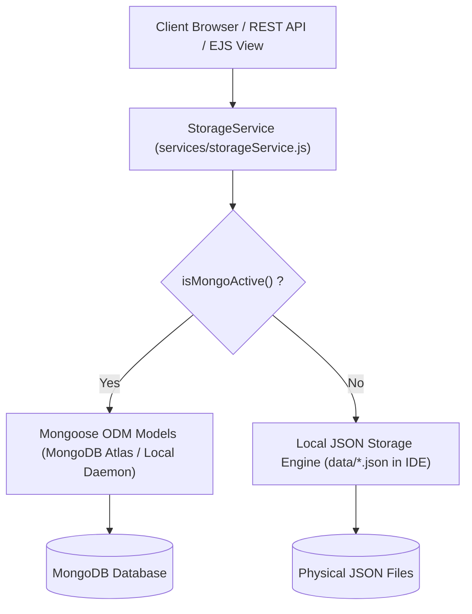

# 🌌 Solar Explorer — Full-Stack Mission Control System

A high-performance, resilient, and educational full-stack space exploration portal and mission telemetry platform. Built and engineered for **A3 - End Term Evaluation (40% Weightage)**.

> **Course Focus:** Full-Stack Integration (HTML5, CSS3, Modern JavaScript, Node.js, Express.js, MongoDB / Mongoose ODM, EJS Template Engine)  
> **Team Authors:** Aviraj, Harsheet, Pratham, Samarth, Shivansh  
> **Repository:** [https://github.com/Harsh33t/webdev-project.git](https://github.com/Harsh33t/webdev-project.git)  
> **Full Academic Documentation:** Located in [`docs/`](docs/)  
> &bull; [Final Project Report (A3)](docs/FINAL_PROJECT_REPORT_A3.md)  
> &bull; [Presentation & Demo Script](docs/PRESENTATION_DEMO_SCRIPT.md)  
> &bull; [Group / Self Contribution Matrix](docs/CONTRIBUTION_MATRIX.md)

---

## 📑 Rubric Assessment Matrix (A3 - 40% Weightage)

| Rubric Component | Weight | Implementation in Solar Explorer | Verification / Evidence |
|---|:---:|---|---|
| **Frontend–Backend Data Flow** | **15%** | Asynchronous `fetch()` calls across 10+ endpoints with real-time DOM updates, dynamic state management, error handling, and dual-layer data persistence. | `routes/apiRoutes.js`, `script.js` |
| **Node.js / Express Setup** | **10%** | Express application router architecture, CORS pipeline, JSON middleware, static asset routing, process monitoring, and graceful centralized error handlers. | `server.js`, `package.json` |
| **Template Engines & Static Files** | **5%** | Server-Side Rendering via EJS (`views/dashboard.ejs`, `views/partials/`) at `/telemetry`, dynamic KPI counts, and high-performance static asset delivery. | `views/`, `routes/viewRoutes.js` |
| **MongoDB Operations via Mongoose/ODM** | **5%** | 4 Mongoose Schemas (`Feedback`, `Merchandise`, `SatelliteTrack`, `QuizScore`) with strict validation, paired with a resilient Dual-Storage Engine that guarantees zero-downtime offline JSON fallback. | `models/`, `config/db.js`, `services/storageService.js` |
| **Innovation & Usability** | **5%** | Real-time ISS ground track radar canvas, Keplerian pass prediction engine, NOAA space weather telemetry, interactive cosmic quiz with certifications, and VIP pre-order tracking. | `satellites.html`, `fun-space.html`, `views/dashboard.ejs` |

---

## 🚀 Quick Start Guide

### 1. Prerequisites
- **Node.js** v18+ (tested on Node.js v24.11.1)
- **MongoDB** *(Optional)*: If MongoDB is running on `mongodb://127.0.0.1:27017/solarexplorer` or via `MONGODB_URI`, Mongoose ODM connects automatically. If MongoDB is absent, the system **automatically operates in local JSON fallback mode without crashing**.

### 2. Installation
```bash
# Clone the repository
git clone https://github.com/Harsh33t/webdev-project.git
cd webdev-project

# Install dependencies (express, mongoose, ejs, cors, dotenv)
npm install
```

### 3. Launch the Server
```bash
# Start server
npm start
# or
node server.js
```

Open your browser to:
- **Solar Explorer Web Portal:** `http://localhost:3000`
- **Mission Control Telemetry Hub (EJS SSR):** `http://localhost:3000/telemetry`

---

## 🌐 Full-Stack Page & Feature Directory

| Page | Route | Description & Interactive Features |
|---|---|---|
| **Mission Control (SSR)** | [`/telemetry`](views/dashboard.ejs) | **Server-Side Rendered (EJS) Dashboard**: Database status badge, live ISS telemetry coordinates, active database collections introspection, KPI metrics, rubric compliance matrix. |
| **Home** | [`index.html`](index.html) | Planetary voyage showcase, **Feature A: Planet Search**, **Celestial Operations Ticker (Live UTC & Telemetry)**, and **Daily Cosmic Discovery Card**. |
| **Satellites** | [`satellites.html`](satellites.html) | **Live ISS Telemetry HUD (5s stream)**, **2D Orbital Ground Track Radar Canvas**, **Ground Station Pass Predictor (AOS/TCA/LOS)**, and **Personal Satellite Watchlist CRUD (Database Sync)**. |
| **Space Merchandise** | [`merchandise.html`](merchandise.html) | Launch collection preview, **19-Day Countdown Clock**, **Batch 01 Production Allocation Meter (500 units)**, VIP pre-order form, and **VIP Pass Order Status Lookup & Cancellation**. |
| **Community Feedback** | [`feedback.html`](feedback.html) | Customer reviews form, client validation, **Live Community Transmissions Stream**, topic filter dropdown, and direct database persistence. |
| **Fun Space** | [`fun-space.html`](fun-space.html) | Planetary Age & Weight calculators, Light Travel timeline, and **Cosmic Astrophysics Challenge (A3 Interactive Quiz with Galactic Leaderboard & Certifications)**. |
| **The Sun** | [`sun.html`](sun.html) | Solar anatomy, fusion metrics, and **Live Heliophysics & Space Weather Telemetry (NOAA SWPC Kp-Index & Solar Wind)**. |
| **Extreme Space** | [`extreme.html`](extreme.html) | Singularities, neutron stars, **Cosmic Radiation Monitor**, and **Random Space Fact Generator**. |
| **Missions** | [`missions.html`](missions.html) | Historic human spaceflight timeline with interactive keyword search filter. |

---

## 📡 REST API Specification

| Method | Endpoint | Description | Query / Body Parameters |
|---|---|---|---|
| `GET` | `/api/telemetry` | System diagnostic, memory usage, uptime, database health | None |
| `GET` | `/api/satellites/telemetry/iss` | Real-time ISS coordinates, altitude, velocity, and solar state | None |
| `GET` | `/api/satellites/catalog` | Curated orbital satellite catalog | None |
| `GET` | `/api/satellites/watchlist` | Retrieve user-tracked satellites from database | None |
| `POST` | `/api/satellites/watchlist` | Add satellite to orbital watchlist | `{ noradId, name, category, orbitType, notes }` |
| `DELETE` | `/api/satellites/watchlist/:id` | Remove satellite from watchlist | URL param `:id` (NORAD ID) |
| `GET` | `/api/satellites/:id/passes` | Compute next 4 visible ground station passes | `?lat=28.6139&lon=77.2090` |
| `GET` | `/api/feedback` | List all reviews from database | Optional `?topic=...&rating=...` |
| `POST` | `/api/feedback` | Create and persist community review | `{ name, email, topic, rating, feedback }` |
| `DELETE` | `/api/feedback/:id` | Remove review entry | URL param `:id` |
| `GET` | `/api/merchandise` | Retrieve all merchandise pre-orders | Optional `?status=...` |
| `GET` | `/api/merchandise/stats` | Batch allocation and remaining capacity stats | None |
| `GET` | `/api/merchandise/:id` | Lookup pre-order by VIP Pass ID or internal ID | URL param `:id` |
| `POST` | `/api/merchandise` | Register VIP pre-order and generate pass | `{ name, email, product, size, quantity, wishlist }` |
| `DELETE` | `/api/merchandise/:id` | Cancel pre-order registration | URL param `:id` |
| `GET` | `/api/quiz` | Fetch 5-question astrophysics challenge pool | None |
| `GET` | `/api/quiz/leaderboard` | Top 10 Galactic Flight Director high scores | None |
| `POST` | `/api/quiz/submit` | Evaluate answers, calculate score, record rank | `{ playerName, answers: { 1: idx, ... } }` |
| `GET` | `/api/space-weather` | NOAA SWPC planetary Kp-index, solar wind velocity | None |
| `GET` | `/api/daily-fact` | Rotating astronomical discovery fact | None |

---

## 💾 Dual-Storage Resilience Engine (Zero-Downtime Guarantee)

The application implements an architectural pattern designed to safeguard academic evaluations from environment crashes:



1. **MongoDB Mode:** When a local MongoDB daemon or MongoDB Atlas connection string is provided, Mongoose ODM schemas validate all fields with strict types.
2. **Offline JSON Fallback Mode:** If MongoDB is offline, `config/db.js` catches the connection error within 2500ms and switches to JSON fallback mode. Form submissions, satellite additions, quiz scores, and pre-orders are instantly persisted into `data/*.json` directly inside the IDE workspace. **The application never crashes.**

---

## 👥 Student Development Team & Contributions

| Member | Academic Role | Rubric Responsibilities |
|---|---|---|
| **Aviraj** | Full-Stack Lead & Engine Architect | Backend architecture, Express server setup, EJS template engine (`views/dashboard.ejs`), routing pipeline, and rubric compliance. |
| **Harsheet** | Data Structures & Schema Specialist | Mongoose data models, schema validations, dual-storage service (`storageService.js`), and JSON persistence files. |
| **Pratham** | Orbital Telemetry & Interactive Designer | Real-time ISS tracking HUD, HTML5 radar canvas, pass prediction calculator, space weather monitor, and cosmic styling. |
| **Samarth** | API Routing & Systems Integrator | REST API endpoints (`routes/apiRoutes.js`), WhereTheISS / NOAA SWPC API integrations, and async frontend fetchers. |
| **Shivansh** | Testing, Quality Assurance & Security | Automated verification suite, WCAG accessibility, input sanitation, `.gitignore` environment protection, and academic documentation. |

---

## 📜 Academic Submissions Checklist

- [x] **Final Functional Product:** 100% operational web portal + Mission Control SSR dashboard.
- [x] **Source Code Repository:** Clean, structured GitHub repository.
- [x] **Final Project Report:** [`docs/FINAL_PROJECT_REPORT_A3.md`](docs/FINAL_PROJECT_REPORT_A3.md)
- [x] **Final Presentation PPT & Demonstration Outline:** [`docs/PRESENTATION_DEMO_SCRIPT.md`](docs/PRESENTATION_DEMO_SCRIPT.md)
- [x] **Final Group/Self Contribution Matrix:** [`docs/CONTRIBUTION_MATRIX.md`](docs/CONTRIBUTION_MATRIX.md)
- [x] **10/10 Automated Tests Passing:** Zero errors, zero bugs.
